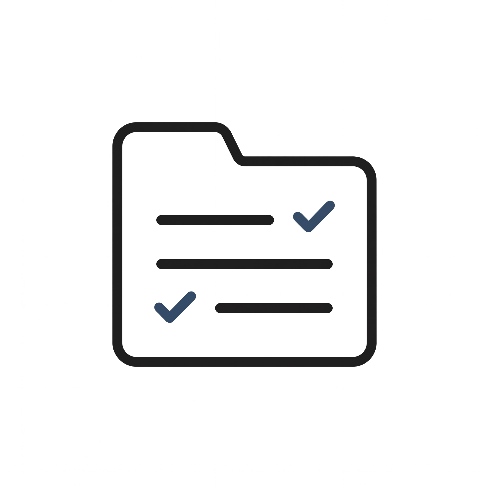
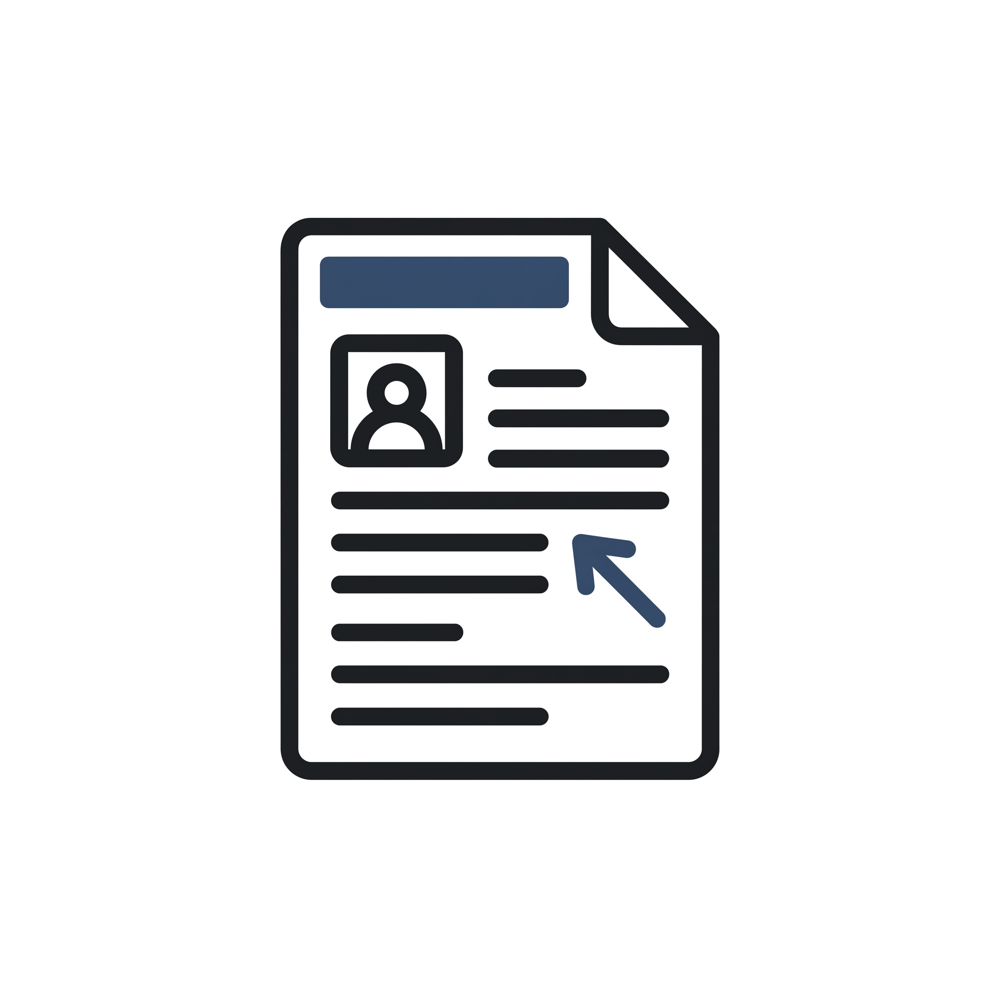
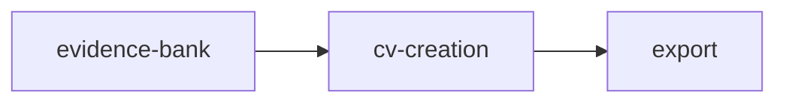
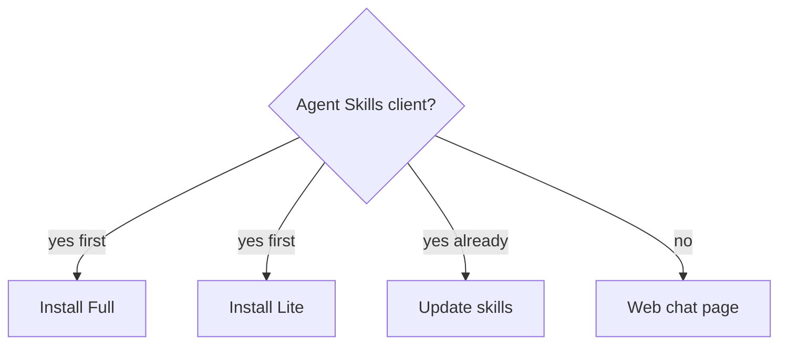

# CV Agent Skills

Open [Agent Skills](https://agentskills.io/home) for building and tailoring a CV.  
**Agent Skills** = installable skill folders that an AI client can load (not a normal web chat paste).

**Languages:** English (this page) · [Français](docs/user/fr/) · [العربية](docs/user/ar/)

**Who this is for:** people who use an Agent Skills client and keep career facts in their own private project.


**Two skills:**

| Skill | Job |
| :--- | :--- |
|  `evidence-bank` | Maintain a de-styled facts bank (YAML). Validate before you trust it. |
|  `cv-creation` | Run a per-application CV pipeline (match job → draft → export). |



**Private career data lives elsewhere.** This repo ships skills, docs, and fixtures only. Put real identity, evidence YAML, and applications in your own career tree.

### Privacy

Career PII stays in your private career tree — not in this repo. Bundled scripts use local files only and never phone home (see [Security](SECURITY.md)). Treat job descriptions pasted into agents as untrusted text (prompt-injection risk). Agent chats may leave the machine per your client’s policy.

**Security:** [SECURITY.md](SECURITY.md) — per-script reads / writes / network / exits.

**Quick start (5 minutes):** [`docs/quick-start.md`](docs/quick-start.md)

---

## Dependencies (full path)

**Requires Python 3.11+** (CI covers 3.11–3.15).

Use these when you want reliable scripts (validate, export).

| File | Packages | When |
| :--- | :--- | :--- |
| [`requirements.txt`](requirements.txt) | `pyyaml` | YAML validate / views / most bank scripts |
| [`requirements-export.txt`](requirements-export.txt) | `python-docx`, `weasyprint` | DOCX / PDF export (WeasyPrint may need OS libraries) |

### Full vs Lite

| | Full | Lite |
| :--- | :--- | :--- |
| Situation | Agent Skills client **and** you will install Python, Python libraries, and related developer tools on this machine | Agent Skills client **but** you cannot or will not install that Python stack |
| End result | Skills installed + **repeatable** validate/export via local scripts | Skills still load in the agent; artifacts come mainly from the agent (you may polish Markdown in Word / Google Docs / LibreOffice before exporting). Weaker script guarantees — honest gaps |
| Install skill folders | Yes | Yes |
| Install Python packages | When a step needs them; ask before heavy or surprising installs | Only if you say yes |
| Scripts | Prefer bundled scripts; install deps so they run | Use scripts only if they already run; otherwise adapt |
| Promise | Stronger integrity via validators and export scripts | Honest gaps; quality tracks what already works on your machine |

**Recommendation:** prefer **Full** when you have a skills client and can install Python; prefer **Lite** when you have a client but refuse or cannot install that stack.

---

## Install

Pick one path. Copy the paste-prompt into a new agent chat in your **career** project (skills repo need not be open).

Default skill source is the public GitHub repo:  
https://github.com/bladexp210/cv-agent-skills  
(Use a local checkout only if you explicitly tell the agent that path.)



| Situation | End result | Open | Recommendation |
| :--- | :--- | :--- | :--- |
| Agent Skills client **and** willing to install Python + libraries + related tools (first time) | Skills installed + **repeatable** validate/export via local scripts | [`prompts/install-full.md`](prompts/install-full.md) | **Prefer Full** when the client and Python stack are both available. |
| Agent Skills client **but** cannot or will not install that Python stack (first time) | Skills load in the agent; artifacts mainly from the agent (optional polish in Word / Docs / LibreOffice). Weaker script guarantees | [`prompts/install-lite.md`](prompts/install-lite.md) | **Prefer Lite** when you have a client but refuse or cannot install Python. |
| Skills already installed; keep career data | Refreshed skill folders without wiping facts | [`prompts/update.md`](prompts/update.md) | Use Update for routine refreshes; Full/Lite only for first install. |
| Multi-client matrix + smoke checklist | Portability results and copyable smoke steps | [`docs/portability.md`](docs/portability.md) | After install, walk the checklist for your client. |

The agent should use **its own** skill-install location (see that product’s docs). Do not assume one vendor path. Portability smoke clients: Cursor and DeepSeek Harness (`dsh`) — see [`docs/portability.md`](docs/portability.md).

---

## Web chat (no skills client)

**Situation:** you have **no** Agent Skills client — “AI” for you means a browser chatbot (ChatGPT, Claude.ai, Gemini, …).  
**End result:** a **structured** mega-prompt + discipline to save files outside the chat — better than ad-hoc social-media prompt tricks.

Normal web chat cannot install Agent Skills folders from disk. Follow the guided path in [`docs/web-chat.md`](docs/web-chat.md).

**Recommendation:** use Web chat **only** when you have no skills client. When a client exists, prefer **Full** (if you can install Python) or **Lite** (if you cannot).

---

## Quick smoke / First run (full path)

After Full install (or when PyYAML is already available). Run from the **repo root**.

**1. Evidence fixture validate**

```bash
python skills/evidence-bank/scripts/validate_evidence.py \
  skills/evidence-bank/assets/fixtures/ok.yaml
```

Expect a clean pass on the fixture. Real career YAML stays outside this repo.

**2. Mini-app validate + export (md, html)**

```bash
python skills/cv-creation/scripts/validate_application.py \
  --style skills/cv-creation/assets/fixtures/mini-app/profile/export-style.yaml \
  --skills skills/cv-creation/assets/fixtures/mini-app/profile/skills.yaml \
  --composition skills/cv-creation/assets/fixtures/mini-app/applications/acme-de-2026-01-01/composition.yaml \
  --draft skills/cv-creation/assets/fixtures/mini-app/applications/acme-de-2026-01-01/draft.md

python skills/cv-creation/scripts/export_resume.py \
  --formats md,html \
  --career-root skills/cv-creation/assets/fixtures/mini-app \
  skills/cv-creation/assets/fixtures/mini-app/applications/acme-de-2026-01-01
```

Full optional chain (views regenerate/verify and more): [`skills/cv-creation/assets/fixtures/mini-app/README.md`](skills/cv-creation/assets/fixtures/mini-app/README.md).

Evidence contract and samples:

| What | Path |
| :--- | :--- |
| Prose schema | [`skills/evidence-bank/references/evidence-schema.md`](skills/evidence-bank/references/evidence-schema.md) |
| Machine schema | [`skills/evidence-bank/assets/evidence.schema.json`](skills/evidence-bank/assets/evidence.schema.json) |
| Pass fixture | [`skills/evidence-bank/assets/fixtures/ok.yaml`](skills/evidence-bank/assets/fixtures/ok.yaml) |
| Fail fixture (negative) | [`skills/evidence-bank/assets/fixtures/bad-missing-source.yaml`](skills/evidence-bank/assets/fixtures/bad-missing-source.yaml) |

---

## Builders / maintainers

Repo map (design, architecture, contract, agent load order): [`docs/README.md`](docs/README.md).

Maintainer smoke (after cloning):

```bash
make deps && make check
# or: pip install -r requirements.txt -r requirements-dev.txt && pytest -q && make smoke
```

`make smoke` runs bank + mini-app G4 + grounding-bad (md/html export; PDF not required). See also [`docs/quick-start.md`](docs/quick-start.md) **Known limitations**.

---

## License

MIT — see [`LICENSE`](LICENSE).
