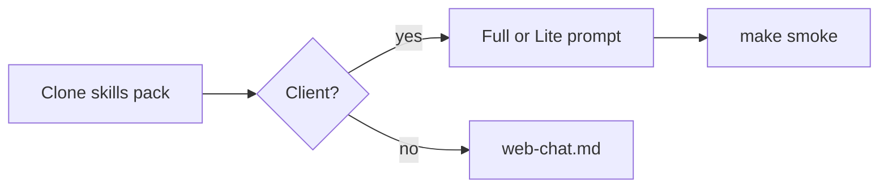

# Quick start (≈5 minutes)

Human overview after clone. Skills pack only — not a full product install guide.

## What this repo is / is not

| Is | Is not |
| :--- | :--- |
| Two Agent Skills (`evidence-bank`, `cv-creation`) + docs, fixtures, scripts | Your private career tree (identity, evidence, applications) |
| Validators / export helpers you run locally | A hosted CV SaaS |

Career facts stay in a separate career project. This repo ships skills and fixtures only.

## Pick a path

| Path | When | Open |
| :--- | :--- | :--- |
| **Full** | Agent Skills client; want reliable Python deps | [`prompts/install-full.md`](../prompts/install-full.md) |
| **Lite** | Same client; ask before package installs | [`prompts/install-lite.md`](../prompts/install-lite.md) |
| **Web chat** | No Agent Skills client (ChatGPT / Claude.ai / …) | [`docs/web-chat.md`](web-chat.md) |

Refresh already-installed skills: [`prompts/update.md`](../prompts/update.md).



## 5-minute smoke after clone

From repo root (run `make deps` first if `import yaml` fails):

```bash
make smoke
```

Backup (same idea as CI / README):

```bash
python3 skills/evidence-bank/scripts/validate_evidence.py \
  skills/evidence-bank/assets/fixtures/ok.yaml

python3 skills/cv-creation/scripts/validate_application.py \
  --style skills/cv-creation/assets/fixtures/mini-app/profile/export-style.yaml \
  --skills skills/cv-creation/assets/fixtures/mini-app/profile/skills.yaml \
  --composition skills/cv-creation/assets/fixtures/mini-app/applications/acme-de-2026-01-01/composition.yaml \
  --draft skills/cv-creation/assets/fixtures/mini-app/applications/acme-de-2026-01-01/draft.md \
  --evidence skills/cv-creation/assets/fixtures/mini-app/profile/evidence.yaml \
  --matching skills/cv-creation/assets/fixtures/mini-app/applications/acme-de-2026-01-01/matching.yaml \
  --identity skills/cv-creation/assets/fixtures/mini-app/profile/identity.yaml
```

Default smoke covers md/html export — not PDF.

## Known limitations (honest)

- **Not 1.0.** Bank and application cold-path still need operator verification on real career data.
- **Portability:** Cursor script smoke **PASS**; DeepSeek Harness (`dsh`) **PARTIAL** — Lite headless may need OpenRouter `--patch`; Full HITL not verified on `dsh`. Details: [`portability.md`](portability.md).
- **PDF:** WeasyPrint needs OS libraries; install via `make deps-export` / `requirements-export.txt` when you need PDF.

## Next

1. Install skills into your career project (`prompts/install-full.md` or Lite).
2. Read portability **Results** in [`portability.md`](portability.md).
3. Trust surface: [`SECURITY.md`](../SECURITY.md).
