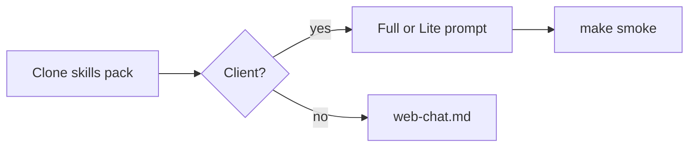

# بداية سريعة (≈5 دقائق)

> **اتجاه القراءة:** هذه الصفحة بالعربية الفصحى وتُقرأ من اليمين إلى اليسار. أوامر الطرفية والمسارات وكتل الشيفرة تبقى حرفية داخل السياج.

نظرة بشرية بعد الاستنساخ. حزمة المهارات فقط — ليست دليل تثبيت منتج كامل.

## ما هو هذا المستودع / وما ليس هو

| هو | ليس |
| :--- | :--- |
| مهارتان من Agent Skills (`evidence-bank`، `cv-creation`) + وثائق وتجهيزات ونصوص | شجرة مسيرتك المهنية الخاصة (هوية، أدلة، طلبات) |
| أدوات تحقق / تصدير تشغّلها محلياً | خدمة سيرة ذاتية مستضافة على السحابة |

حقائق المسيرة تبقى في مشروع مهني منفصل. هذا المستودع يوفّر المهارات والتجهيزات فقط.

## اختر مساراً

| المسار | متى | افتح | التوصية |
| :--- | :--- | :--- | :--- |
| **Full** | عميل Agent Skills؛ تريد اعتماديات بايثون موثوقة | [`../../../prompts/ar/install-full.md`](../../../prompts/ar/install-full.md) | **مُوصى به** للتثبيت الأول عندما تريد `make smoke` / أدوات التحقق. |
| **Lite** | نفس العميل؛ اسأل قبل تثبيت الحزم | [`../../../prompts/ar/install-lite.md`](../../../prompts/ar/install-lite.md) | استخدمه عندما يجب أن تنتظر تثبيت الحزم موافقتك. |
| **Web chat** | بلا عميل Agent Skills | [`web-chat.md`](web-chat.md) | فقط عندما يتعذّر تثبيت مجلدات المهارات. |

تحديث المهارات المُثبَّتة مسبقاً: [`../../../prompts/ar/update.md`](../../../prompts/ar/update.md).



## فحص سريع خلال 5 دقائق بعد الاستنساخ

من جذر المستودع (شغّل `make deps` أولاً إذا فشل `import yaml`):

```bash
make smoke
```

بديل (نفس فكرة CI / README):

```bash
python3 skills/evidence-bank/scripts/validate_evidence.py \
  skills/evidence-bank/assets/fixtures/ok.yaml

python3 skills/cv-creation/scripts/validate_application.py \
  --style skills/cv-creation/assets/fixtures/mini-app/profile/export-style.yaml \
  --skills skills/cv-creation/assets/fixtures/mini-app/profile/skills.yaml \
  --composition skills/cv-creation/assets/fixtures/mini-app/applications/acme-de-2026-01-01/composition.yaml \
  --draft skills/cv-creation/assets/fixtures/mini-app/applications/acme-de-2026-01-01/draft.md \
  --evidence skills/cv-creation/assets/fixtures/mini-app/profile/evidence.yaml \
  --matching skills/cv-creation/assets/fixtures/mini-app/applications/acme-de-2026-01-01/matching.yaml \
  --identity skills/cv-creation/assets/fixtures/mini-app/profile/identity.yaml
```

الفحص الافتراضي يغطي تصدير md/html — وليس PDF.

## حدود معروفة (بصراحة)

- **ليس إصدار 1.0.** مسار البنك والتطبيق البارد ما زال يحتاج تحقق المشغّل على بيانات مهنية حقيقية.
- **قابلية النقل:** فحص سكربتات Cursor **PASS**. DeepSeek Harness (`dsh`): وضع **web** Lite **PASS** (البند 1 جزئي — نسخة محلية)؛ وضع **headless** Lite **PARTIAL** (قد يحتاج OpenRouter `--patch`). HITL الكامل غير مُتحقق على `dsh`. التفاصيل: [`portability.md`](../../portability.md) (إنجليزي).
- **PDF:** WeasyPrint يحتاج مكتبات نظام؛ ثبّت عبر `make deps-export` / `requirements-export.txt` عند الحاجة لـ PDF.

## التالي

1. ثبّت المهارات في مشروعك المهني (`prompts/ar/install-full.md` أو Lite).
2. اقرأ نتائج قابلية النقل في [`portability.md`](../../portability.md) (إنجليزي).
3. سطح الثقة: [`SECURITY.md`](../../../SECURITY.md) (إنجليزي) · مختصر عربي: [`privacy-security.md`](privacy-security.md).

**الخصوصية:** [`privacy-security.md`](privacy-security.md) · الكامل بالإنجليزية [`SECURITY.md`](../../../SECURITY.md).

**اللغات:** [English](../../quick-start.md) · [Français](../fr/quick-start.md) · [العربية](quick-start.md)
