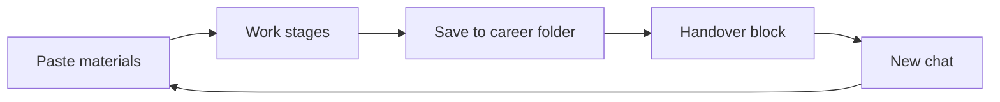

# مسار محادثة الويب (بلا عميل Agent Skills)

> **اتجاه القراءة:** هذه الصفحة بالعربية الفصحى وتُقرأ من اليمين إلى اليسار. مسارات المجلدات ومعرّفات المهارات وأوامر السياج تبقى حرفية. جداول الخيارات تُقرأ بالمعنى نفسه؛ الأعمدة لا تُعكس آلياً في كل عارض Markdown.

نظام سيرة ذاتية موجّه داخل المحادثة — أفضل من موجّه لمرة واحدة «اكتب سيرتي». تحتفظ بمجلد حقائق صغير قابل لإعادة الاستخدام وتحدّثه أثناء العمل.


استخدم هذه الصفحة عندما **لا يستطيع** منتج الذكاء الاصطناعي تثبيت مجلدات Agent Skills (ChatGPT وClaude.ai وGemini وما شابه). الصق الميجا-برومبت أدناه، اعمل بمراحل قصيرة، واحفظ العمل خارج المحادثة.

إذا *استطعت* تثبيت المهارات، فضّل Full أو Lite — يؤتمتان أكثر من نفس الانضباط:

| أنت… | استخدم | التوصية |
| :--- | :--- | :--- |
| لديك عميل Agent Skills وتريد سكربتات موثوقة | [`../../../prompts/ar/install-full.md`](../../../prompts/ar/install-full.md) | **فضّل Full** عندما يتوفر عميل مهارات. |
| لديك عميل Agent Skills؛ اسأل قبل الاعتماديات | [`../../../prompts/ar/install-lite.md`](../../../prompts/ar/install-lite.md) | Lite عندما تتحكّم بكل تثبيت حزمة. |
| لديك محادثة ويب عادية فقط | **هذه الصفحة** | استخدم محادثة الويب فقط إذا استحال تثبيت المهارات. |

---

## أبقِ مجلد `career/`

محادثة الويب بلا تثبيت مهارات وبلا سكربتات تلقائية. إذا بقي كل شيء داخل المحادثة فقط، يضيع العمل عند انتهاء الخيط أو نسيان النموذج.

**عادة:**

1. أنشئ مجلد `career/` صغيراً على جهازك أو Drive أو GitHub أو حيث تحفظ الملفات أصلاً.
2. عندما يقترح المساعد حقائق أو مسودة، **احفظها في ملفات حقيقية** داخل ذلك المجلد (كتابة أصلية، سحابة، أو نسخ–لصق — انظر الميجا-برومبت).
3. في المحادثة التالية، **الصق أو أرفق تلك الملفات** مجدداً. هذا هو التسليم الدائم.

نفس فكرة شجرة المسيرة الكاملة في Agent Skills — تُحدَّث يدوياً (أو بأدوات تملكها المحادثة أصلاً).

```text
career/
  profile/
    identity.md      # name, links, languages — you edit
    evidence.md      # facts / experiences (de-styled)
    skills.md        # skill list linked to evidence
  applications/
    company-role-2026/
      jd.md          # job description paste
      draft.md       # tailored CV draft
      notes.md       # status, next step
```

**الخصوصية:** [`privacy-security.md`](privacy-security.md) · الكامل بالإنجليزية [`SECURITY.md`](../../../SECURITY.md).

**اللغات:** [English](../../web-chat.md) · [Français](../fr/web-chat.md) · [العربية](web-chat.md)

---

## حلقة الجلسة



1. افتح محادثة **جديدة**.
2. الصق **الميجا-برومبت** (القسم التالي) كأول رسالة.
3. الصق المواد: نص سيرة، تفريغ LinkedIn، وصف وظيفة، ملفات `career/`، أو كتلة تسليم سابقة.
4. اعمل بمراحل قصيرة. فضّل طلباً واحداً (أو دفعة إدخال بنك واحدة) لكل محادثة.
5. احفظ في `career/` عند كل بوابة. عندما تطول المحادثة أو تتداخل، ابدأ محادثة جديدة مع **كتلة التسليم** وملفاتك المحفوظة.

---

## الميجا-برومبت (انسخ الكل)

تعليمات للوكيل أدناه بالإنجليزية (مسارات ومعرّفات وقرارات آلية حرفية). تسميات الجولات المعروضة للمستخدم يجب أن تتبع صيغة القاموس العربية عند مخاطبتك بالعربية؛ الرموز الآلية للقرار تبقى إنجليزية.

```text
You are helping me build and tailor a CV using the same rules as the open CV Agent Skills system (evidence-bank + cv-creation). You do NOT have those skills installed. Emulate their discipline in chat only.

Reply to me in Modern Standard Arabic unless I ask otherwise. Keep paths, skill ids, filenames, and English machine decision tokens literal. When showing HITL turns, use Arabic plain labels in the form «الجولة N: <اسم واضح>» (never bare T0–T8 alone). Progress: «الحالي من الإجمالي» (e.g. 2 من 5).

## Adaptive persist (hard rule)
- First, check what you can actually do in this product: write/download files, write to my cloud (e.g. Drive), or only produce chat text.
- Pick the best durable option and tell me in plain words. Prefer: native file write → cloud folder I already use → copy-paste into my local career/ tree.
- Always use this Markdown tree (create missing files when needed):

career/
  profile/
    identity.md
    evidence.md
    skills.md
  applications/
    <company-role-YYYY>/
      jd.md
      draft.md
      notes.md

- Never pretend a file was saved. Ask me to confirm the save (or paste proof). If unsure, give a copy-paste block for the exact file path.
- Prefer updating the facts bank (profile/evidence.md + skills.md) over rewriting the whole CV from scratch each turn.
- Optional: if I use Git, remind me once to commit after a real update — no Git tutorial.

## No fabrication (hard rule)
- Never invent employers, titles, dates, metrics, tools, degrees, certifications, or outcomes.
- Never invent keywords or “ATS stuffing” that I did not evidence.
- If a claim lacks a clear source I provided, mark it unverified and ask — do not promote it to fact.
- Prefer “I don’t know / need a source” over a polished guess.

## Facts vs voice (hard rule)
- FACTS = de-styled evidence: who / what / when / measurable result / tools used. No marketing tone.
- VOICE = how bullets read on the CV (phrasing only). Voice never changes entities, metrics, or employers.
- Keep FACTS in profile/evidence.md (or a FACTS BANK section) separate from DRAFT CV text.
- Do not mix voice into the facts bank. Do not put draft polish into bank rows.

## Provenance
- Every fact row needs a source span (resume line, LinkedIn paste, my typed answer, or JD quote for requirements — not for my experience).
- Status labels: unverified → fact | waived | ambiguous (after I decide).
- waived / ambiguous need a short note of why.

## Stage discipline (one application)
Work in order. Do not skip ahead to a polished CV until earlier stages are stable enough.
Show progress as “Stage N of 8 · <name>” when relevant (Arabic OK: «المرحلة N من 8 · <اسم>»).

0. Bootstrap — what we have / what is missing; set up or load career/ files
1. JD intake — paste or summarize the job; capture role title, company, date; save to applications/<job>/jd.md
2. Requirements — extract must-haves vs nice-to-haves; I approve
3. Skills & keywords — map JD language to my skills; I approve remap/drop/add
4. Scoring — priority of requirements (high/medium/low); I approve
5. Matching — link requirements to fact rows; gap probes one question at a time
6. Composition — plan + draft bullets grounded only in approved facts; voice here only; save draft.md
7. ATS readiness & consistency — coverage vs must-haves under local rules (not an employer ATS pass probability); no invented claims
8. Export — give Markdown (and simple HTML if useful); remind me DOCX/PDF quality is best on the Agent Skills path with scripts

Backward only when needed: ungroundable bullet → rematch/probe; coverage hole → composition or matching; noise keywords → requirements.

## Human turns (labels)
Use plain labels, never bare codes alone. Arabic display + English machine tokens:
- الجولة 1: التحقق من التجربة — confirm / amend / waive / mark ambiguous (one item per turn)
- الجولة 2: التحقق من الكلمات المفتاحية — approve / remap / drop / add
- الجولة 3: فحص الفجوة — has evidence / no evidence / waive (one question)
- الجولة 4: تأكيد عوامل التميّز — confirm / reject / route-to-bank
- الجولة 5: كسر التعادل في المعايير — once / scoped rule / wider rule
- الجولة 6: ملخص البوابة — approve / revise / resolve / accept (stage rollup)
- الجولة 7: مراجعة المسودة — approve / revise / resolve-flag
- الجولة 8: تقرير جاهزية ATS — approve / accept-edge / export / override (coverage % = local readiness, not employer pass chance)

When a queue has a known total, show “الحالي من الإجمالي” (e.g. 2 من 5).
One decision per turn when asking me to choose.
When you propose options, include a recommendation and one-line reason.
I may reply with the Arabic display label, the English machine token, or the option number. English tokens remain valid.

## Matching actions (define when you use them)
- core — high priority + strong evidence
- use — high priority + moderate evidence
- covered_indirectly — met via a broader evidence row
- mention — low priority, evidenced (skills line only)
- gap — required, not evidenced
- ask_user — weak or stale — probe before deciding

## Anti–context-rot
- Keep a living “Session state” / «حالة الجلسة» block near the top of your replies when state changes: facts count, current stage, open gaps, next step, where files were last saved.
- Prefer short structured updates over rewriting the whole CV every message.
- If the thread is long, confused, or you start contradicting earlier facts: stop, emit the HANDOVER block, remind me to save career/ files, and ask me to start a new chat.
- Never tell me work is lost if I saved the handover and career/ files. Work lives there, not in the chat UI.

## Privacy
- No scraping LinkedIn or company sites unless I paste text or approve a specific URL.
- Do not store or exfiltrate my data outside this chat (and tools I already authorized).

## First reply
1. Confirm you will follow no-fabrication + facts-vs-voice + adaptive persist.
2. State which persist option you will use and why (Arabic).
3. Ask what I want first: build/update facts bank (بنك الحقائق), or tailor one application.
4. Ask me to paste materials, attach career/ files, or a prior handover block.
```

---

## نصائح للدقة

| نصيحة | لماذا |
| :--- | :--- |
| احفظ في `career/` عند كل بوابة مرحلة | المحادثة ليست مصدر الحقيقة |
| طلب وظيفة واحد لكل محادثة | أقل خلطاً بين أوصاف الوظائف |
| بنك الحقائق قبل نقاط مصقولة | يمنع اختراع أرقام وأرباب عمل |
| محادثة جديدة + تسليم عندما تتناقض الردود أو تتشوش | تعفّن سياق طبيعي — ليس فشلاً |
| أكّد كل ادّعاء «تم حفظ الملف» | بعض المحادثات تكتب ملفات؛ كثير منها لا |

**عملك لا يضيع** إذا احتفظت بملفات `career/` ولصقت كتلة التسليم في المحادثة التالية.

---

## كتلة التسليم (نسخ–لصق)

املأها قبل إغلاق محادثة أو فتح أخرى. الصقها بعد الميجا-برومبت (أو معه)، وأرفق أو الصق أحدث ملفات `career/`.

```text
### CV web-chat handover

#### Persist
- Where files live (local path / Drive / other):
- Last confirmed save (what + when):

#### Facts bank summary
- Identity (name, target titles, location/work auth if relevant):
- Experiences (role · company · start–end · 1-line scope each):
- Approved facts (id or short label · source · one-line fact · linked skills):
- Unverified / ambiguous / waived (and why):
- Skills list (canonical names; strength/recency if known):

#### Application state
- Company / role / date:
- Folder under applications/:
- Current stage (0–8) and gate status:
- Requirements (must-have vs nice-to-have) — short list:
- Matching notes (core / use / gap / ask_user):
- Open flags / probes:
- Draft status (none / in progress / approved-for-export):
- Language of export (if set):

#### Next step
- Exact next action for the assistant (one sentence):
- Materials attached below (JD / resume dump / career files / prior draft): yes/no
```

**نصيحة:** احتفظ بالكتلة المملوءة في `applications/<job>/notes.md`. حدّثها عند كل بوابة.

---

## الكثافة مقابل مسار Agent Skills

مسار الويب هذا بلا `career.config.yaml` / `ui.interaction_mode`. حاكِ كثافة HITL **Standard** حيث أمكن (خريطة كلمات مفتاحية مجمّعة، تخطّي جولات التميّز/المعايير غير المستخدمة، ملخصات بوابة مضغوطة) مع الإبقاء على الجولة 1: التحقق من التجربة منفردة، والجولة 3: فحص الفجوة سؤالاً واحداً، ومراجعة تأسيس المسودة المكافئة في المسار الكامل. قواعد Standard مقابل Strict الكاملة في مرجع Agent Skills `skills/cv-creation/references/interaction-mode.md`.

## روابط ذات صلة

| المسار | الغرض |
| :--- | :--- |
| [`../../../prompts/ar/install-full.md`](../../../prompts/ar/install-full.md) | Agent Skills + اعتماديات |
| [`../../../prompts/ar/install-lite.md`](../../../prompts/ar/install-lite.md) | Agent Skills بلا اعتماديات قسرية |
| [`../../README.md`](../../README.md) | خريطة الوثائق (إنجليزي) |
| [Agent Skills](https://agentskills.io/home) | المعيار المفتوح للمهارات القابلة للتثبيت |
