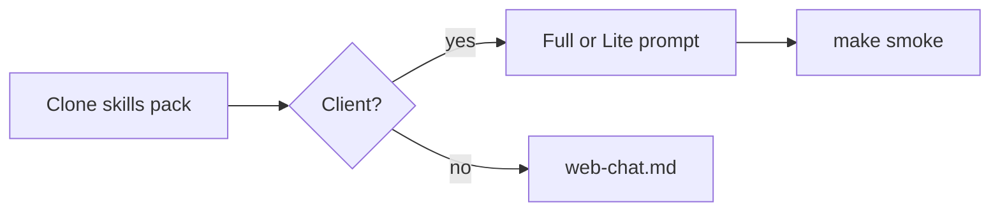

# Démarrage rapide (≈5 minutes)

## Ce que ce dépôt est / n’est pas

| Est | N’est pas |
| :--- | :--- |
| Deux Agent Skills (`evidence-bank`, `cv-creation`) + docs, fixtures, scripts | Votre arborescence carrière privée (identité, preuves, candidatures) |
| Validateurs / aides d’export que vous exécutez en local | Un SaaS CV hébergé |

Les faits de carrière restent dans un projet carrière séparé. Ce dépôt livre seulement les skills et les fixtures.

## Choisir un parcours

| Parcours | Quand | Ouvrir | Recommandation |
| :--- | :--- | :--- | :--- |
| **Full** | Client Agent Skills ; dépendances Python fiables | [`../../../prompts/fr/install-full.md`](../../../prompts/fr/install-full.md) | **Recommandé** pour une première install si vous voulez `make smoke` / validateurs. |
| **Lite** | Même client ; demander avant les installs de paquets | [`../../../prompts/fr/install-lite.md`](../../../prompts/fr/install-lite.md) | Quand chaque install de paquet doit attendre votre OK. |
| **Web chat** | Pas de client Agent Skills | [`web-chat.md`](web-chat.md) | Seulement si vous ne pouvez pas installer les dossiers de skills. |

Rafraîchir des skills déjà installés : [`../../../prompts/fr/update.md`](../../../prompts/fr/update.md).



## Smoke en 5 minutes après le clone

Depuis la racine du dépôt (lancez `make deps` d’abord si `import yaml` échoue) :

```bash
make smoke
```

Secours (même idée que CI / README) :

```bash
python3 skills/evidence-bank/scripts/validate_evidence.py \
  skills/evidence-bank/assets/fixtures/ok.yaml

python3 skills/cv-creation/scripts/validate_application.py \
  --style skills/cv-creation/assets/fixtures/mini-app/profile/export-style.yaml \
  --skills skills/cv-creation/assets/fixtures/mini-app/profile/skills.yaml \
  --composition skills/cv-creation/assets/fixtures/mini-app/applications/acme-de-2026-01-01/composition.yaml \
  --draft skills/cv-creation/assets/fixtures/mini-app/applications/acme-de-2026-01-01/draft.md \
  --evidence skills/cv-creation/assets/fixtures/mini-app/profile/evidence.yaml \
  --matching skills/cv-creation/assets/fixtures/mini-app/applications/acme-de-2026-01-01/matching.yaml \
  --identity skills/cv-creation/assets/fixtures/mini-app/profile/identity.yaml
```

Le smoke par défaut couvre l’export md/html — pas le PDF.

## Limites connues (honnêtes)

- **Pas encore 1.0.** Les chemins froids banque et candidature exigent encore une vérification opérateur sur de vraies données carrière.
- **Portabilité :** smoke scripts Cursor **PASS**. DeepSeek Harness (`dsh`) : **web** Lite script smoke **PASS** (item 1 partiel — copie locale) ; **headless** Lite **PARTIAL** (peut nécessiter OpenRouter `--patch`). HITL complet non vérifié sur `dsh`. Détails : [`portability.md`](../../portability.md), [`portability-smoke-dsh-web.md`](../../portability-smoke-dsh-web.md).
- **PDF :** WeasyPrint nécessite des bibliothèques OS ; installer via `make deps-export` / `requirements-export.txt` quand vous avez besoin du PDF.

## Ensuite

1. Installer les skills dans votre projet carrière (`prompts/fr/install-full.md` ou Lite).
2. Lire les **Results** de portabilité dans [`portability.md`](../../portability.md).
3. Surface de confiance : [`SECURITY.md`](../../../SECURITY.md).

**Confidentialité :** [`privacy-security.md`](privacy-security.md) · complet EN [`SECURITY.md`](../../../SECURITY.md).

**Langues :** [English](../../quick-start.md) · [Français](quick-start.md) · [العربية](../ar/quick-start.md)
