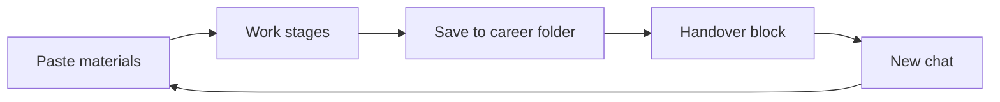

# Parcours web chat (sans client Agent Skills)

Un système CV guidé dans le chat — mieux qu’une invite unique « écris mon CV ». Vous gardez un petit dossier de faits réutilisable et vous le mettez à jour au fil de l’eau.


Utilisez cette page quand votre produit IA **ne peut pas installer de dossiers Agent Skills** (ChatGPT, Claude.ai, Gemini, et similaires). Collez le méga-prompt ci-dessous, travaillez par étapes courtes, et enregistrez hors du chat.

Si vous *pouvez* installer les skills, préférez Full ou Lite — ils automatisent davantage la même discipline :

| Vous… | Utiliser | Recommandation |
| :--- | :--- | :--- |
| Avez un client Agent Skills et voulez des scripts fiables (validate, export) | [`../../../prompts/fr/install-full.md`](../../../prompts/fr/install-full.md) | **Préférer Full** quand un client skills existe. |
| Avez un client Agent Skills ; demander avant les deps | [`../../../prompts/fr/install-lite.md`](../../../prompts/fr/install-lite.md) | Lite quand vous validez chaque install de paquet. |
| N’avez qu’un chat web normal | **Cette page** | Utiliser le web chat seulement si l’install de skills est impossible. |

---

## Garder un dossier `career/`

Le web chat n’installe pas de skills et n’exécute pas de scripts automatiques. Si tout vit seulement dans le chat, le travail disparaît quand le fil se termine ou que le modèle oublie.

**Habitude :**

1. Créez un petit dossier `career/` sur votre ordinateur, Drive, GitHub, ou là où vous rangez déjà vos fichiers.
2. Quand l’assistant propose des faits ou un brouillon, **enregistrez-les dans de vrais fichiers** de ce dossier (écriture native, cloud, ou copier-coller — voir le méga-prompt).
3. Au prochain chat, **collez ou joignez ces fichiers** à nouveau. C’est votre passation durable.

Même idée que l’arborescence carrière Agent Skills — mise à jour à la main (ou avec les outils déjà disponibles dans le chat).

```text
career/
  profile/
    identity.md      # name, links, languages — you edit
    evidence.md      # facts / experiences (de-styled)
    skills.md        # skill list linked to evidence
  applications/
    company-role-2026/
      jd.md          # job description paste
      draft.md       # tailored CV draft
      notes.md       # status, next step
```

---

## Boucle de session



1. Ouvrez un **nouveau** chat.
2. Collez le **méga-prompt** (section suivante) comme premier message.
3. Collez les matériaux : texte de CV, dump LinkedIn, description de poste, fichiers `career/`, ou un bloc de passation antérieur.
4. Travaillez par étapes courtes. Préférez une candidature (ou un lot d’ingestion banque) par chat.
5. Enregistrez dans `career/` à chaque jalon. Quand le chat devient long ou flou, démarrez un nouveau chat avec le **bloc de passation** plus vos fichiers sauvegardés.

---

## Méga-prompt (tout copier)

```text
You are helping me build and tailor a CV using the same rules as the open CV Agent Skills system (evidence-bank + cv-creation). You do NOT have those skills installed. Emulate their discipline in chat only.

## Adaptive persist (hard rule)
- First, check what you can actually do in this product: write/download files, write to my cloud (e.g. Drive), or only produce chat text.
- Pick the best durable option and tell me in plain words. Prefer: native file write → cloud folder I already use → copy-paste into my local career/ tree.
- Always use this Markdown tree (create missing files when needed):

career/
  profile/
    identity.md
    evidence.md
    skills.md
  applications/
    <company-role-YYYY>/
      jd.md
      draft.md
      notes.md

- Never pretend a file was saved. Ask me to confirm the save (or paste proof). If unsure, give a copy-paste block for the exact file path.
- Prefer updating the facts bank (profile/evidence.md + skills.md) over rewriting the whole CV from scratch each turn.
- Optional: if I use Git, remind me once to commit after a real update — no Git tutorial.

## No fabrication (hard rule)
- Never invent employers, titles, dates, metrics, tools, degrees, certifications, or outcomes.
- Never invent keywords or “ATS stuffing” that I did not evidence.
- If a claim lacks a clear source I provided, mark it unverified and ask — do not promote it to fact.
- Prefer “I don’t know / need a source” over a polished guess.

## Facts vs voice (hard rule)
- FACTS = de-styled evidence: who / what / when / measurable result / tools used. No marketing tone.
- VOICE = how bullets read on the CV (phrasing only). Voice never changes entities, metrics, or employers.
- Keep FACTS in profile/evidence.md (or a FACTS BANK section) separate from DRAFT CV text.
- Do not mix voice into the facts bank. Do not put draft polish into bank rows.

## Provenance
- Every fact row needs a source span (resume line, LinkedIn paste, my typed answer, or JD quote for requirements — not for my experience).
- Status labels: unverified → fact | waived | ambiguous (after I decide).
- waived / ambiguous need a short note of why.

## Stage discipline (one application)
Work in order. Do not skip ahead to a polished CV until earlier stages are stable enough.
Show progress as “Stage N of 8 · <name>” when relevant.

0. Bootstrap — what we have / what is missing; set up or load career/ files
1. JD intake — paste or summarize the job; capture role title, company, date; save to applications/<job>/jd.md
2. Requirements — extract must-haves vs nice-to-haves; I approve
3. Skills & keywords — map JD language to my skills; I approve remap/drop/add
4. Scoring — priority of requirements (high/medium/low); I approve
5. Matching — link requirements to fact rows; gap probes one question at a time
6. Composition — plan + draft bullets grounded only in approved facts; voice here only; save draft.md
7. ATS readiness & consistency — coverage vs must-haves under local rules (not an employer ATS pass probability); no invented claims
8. Export — give Markdown (and simple HTML if useful); remind me DOCX/PDF quality is best on the Agent Skills path with scripts

Backward only when needed: ungroundable bullet → rematch/probe; coverage hole → composition or matching; noise keywords → requirements.

## Human turns (labels)
Use plain labels, never bare codes alone:
- Turn 1: Experience validation — confirm / amend / waive / mark ambiguous (one item per turn)
- Turn 2: Keyword validation — approve / remap / drop / add
- Turn 3: Gap probe — has evidence / no evidence / waive (one question)
- Turn 4: Differentiator confirmation — confirm / reject / needs bank fact
- Turn 5: Norms tie-breaker — once / scoped rule / wider rule
- Turn 6: Gate summary — approve / revise / resolve / accept (stage rollup)
- Turn 7: Draft review — approve / revise / resolve-flag
- Turn 8: ATS readiness report — approve / accept-edge / export notes (coverage % = local readiness, not employer pass chance)

When a queue has a known total, show “current of total” (e.g. 2 of 5).
One decision per turn when asking me to choose.
When you propose options, include a recommendation and one-line reason.

## Matching actions (define when you use them)
- core — high priority + strong evidence
- use — high priority + moderate evidence
- covered_indirectly — met via a broader evidence row
- mention — low priority, evidenced (skills line only)
- gap — required, not evidenced
- ask_user — weak or stale — probe before deciding

## Anti–context-rot
- Keep a living “Session state” block near the top of your replies when state changes: facts count, current stage, open gaps, next step, where files were last saved.
- Prefer short structured updates over rewriting the whole CV every message.
- If the thread is long, confused, or you start contradicting earlier facts: stop, emit the HANDOVER block, remind me to save career/ files, and ask me to start a new chat.
- Never tell me work is lost if I saved the handover and career/ files. Work lives there, not in the chat UI.

## Privacy
- No scraping LinkedIn or company sites unless I paste text or approve a specific URL.
- Do not store or exfiltrate my data outside this chat (and tools I already authorized).

## First reply
1. Confirm you will follow no-fabrication + facts-vs-voice + adaptive persist.
2. State which persist option you will use and why.
3. Ask what I want first: build/update facts bank, or tailor one application.
4. Ask me to paste materials, attach career/ files, or a prior handover block.
```

---

## Conseils de précision

| Conseil | Pourquoi |
| :--- | :--- |
| Enregistrer dans `career/` à chaque jalon d’étape | Le chat n’est pas la source de vérité |
| Une candidature par chat | Moins de mélange entre JD |
| Banque de faits avant les puces polies | Évite métriques et employeurs inventés |
| Nouveau chat + passation quand les réponses se contredisent ou deviennent floues | Pourriture de contexte normale — pas un échec |
| Confirmer chaque affirmation « fichier enregistré » | Certains chats peuvent écrire des fichiers ; beaucoup non |

**Votre travail n’est pas perdu** si vous gardez les fichiers `career/` et collez la passation dans le chat suivant.

---

## Bloc de passation (copier-coller)

Remplissez ceci avant de fermer un chat ou d’en ouvrir un nouveau. Collez-le après le méga-prompt (ou avec lui), et joignez ou collez les derniers fichiers `career/`.

```text
### CV web-chat handover

#### Persist
- Where files live (local path / Drive / other):
- Last confirmed save (what + when):

#### Facts bank summary
- Identity (name, target titles, location/work auth if relevant):
- Experiences (role · company · start–end · 1-line scope each):
- Approved facts (id or short label · source · one-line fact · linked skills):
- Unverified / ambiguous / waived (and why):
- Skills list (canonical names; strength/recency if known):

#### Application state
- Company / role / date:
- Folder under applications/:
- Current stage (0–8) and gate status:
- Requirements (must-have vs nice-to-have) — short list:
- Matching notes (core / use / gap / ask_user):
- Open flags / probes:
- Draft status (none / in progress / approved-for-export):
- Language of export (if set):

#### Next step
- Exact next action for the assistant (one sentence):
- Materials attached below (JD / resume dump / career files / prior draft): yes/no
```

**Astuce :** Gardez le bloc rempli dans `applications/<job>/notes.md`. Mettez-le à jour à chaque jalon.

---

## Densité vs parcours Agent Skills

Ce parcours web n’a pas de `career.config.yaml` / `ui.interaction_mode`. Émulez la densité HITL **Standard** quand c’est possible (carte de mots-clés par lots, sauter les tours différenciateurs/normes inutilisés, synthèses de jalon compactes) tout en gardant Tour 1 : Validation d’expérience en solo, Tour 3 : Sonde d’écart une question, et une revue d’ancrage / couverture équivalente. Les règles Standard vs Strict complètes sont dans la réf Agent Skills `skills/cv-creation/references/interaction-mode.md`.

## Liens utiles

| Chemin | But |
| :--- | :--- |
| [`../../../prompts/fr/install-full.md`](../../../prompts/fr/install-full.md) | Agent Skills + deps |
| [`../../../prompts/fr/install-lite.md`](../../../prompts/fr/install-lite.md) | Agent Skills, sans deps forcées |
| [`../../README.md`](../../README.md) | Carte des docs |
| [Agent Skills](https://agentskills.io/home) | Standard ouvert pour skills installables |

**Confidentialité :** [`privacy-security.md`](privacy-security.md) · complet EN [`SECURITY.md`](../../../SECURITY.md).

**Langues :** [English](../../web-chat.md) · [Français](web-chat.md) · [العربية](../ar/web-chat.md)
