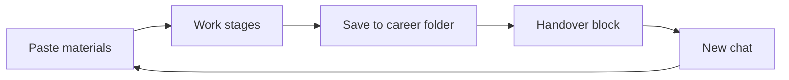

# Web chat path (no Agent Skills client)

A guided CV system in chat — better than a one-shot “write my resume” prompt. You keep a small reusable facts folder and update it as you go.


Use this page when your AI product **cannot install Agent Skills folders** (ChatGPT, Claude.ai, Gemini, and similar). Paste the mega-prompt below, work in short stages, and save work outside the chat.

If you *can* install skills, prefer Full or Lite — they automate more of the same discipline:

| You… | Use |
| :--- | :--- |
| Have an Agent Skills client and want reliable scripts (validate, export) | [`prompts/install-full.md`](../prompts/install-full.md) |
| Have an Agent Skills client and do not want forced dependency installs | [`prompts/install-lite.md`](../prompts/install-lite.md) |
| Only have a normal web chat | **This page** |

---

## Keep a `career/` folder

Web chat has no skill install and no automatic scripts. If everything lives only in the chat, work dies when the thread ends or the model forgets.

**Habit:**

1. Create a small `career/` folder on your computer, Drive, GitHub, or wherever you already keep files.
2. When the assistant proposes facts or a draft, **save them into real files** in that folder (native write, cloud, or copy-paste — see mega-prompt).
3. Next chat, **paste or attach those files** again. That is your durable handover.

Same idea as the full Agent Skills career tree — updated by hand (or by tools the chat already has).

```text
career/
  profile/
    identity.md      # name, links, languages — you edit
    evidence.md      # facts / experiences (de-styled)
    skills.md        # skill list linked to evidence
  applications/
    company-role-2026/
      jd.md          # job description paste
      draft.md       # tailored CV draft
      notes.md       # status, next step
```

---

## Session loop



1. Open a **new** chat.
2. Paste the **mega-prompt** (next section) as the first message.
3. Paste materials: resume text, LinkedIn dump, job description, `career/` files, or a prior handover block.
4. Work in short stages. Prefer one job application (or one bank ingest batch) per chat.
5. Save into `career/` at each gate. When the chat gets long or fuzzy, start a new chat with the **handover block** plus your saved files.

---

## Mega-prompt (copy all)

```text
You are helping me build and tailor a CV using the same rules as the open CV Agent Skills system (evidence-bank + cv-creation). You do NOT have those skills installed. Emulate their discipline in chat only.

## Adaptive persist (hard rule)
- First, check what you can actually do in this product: write/download files, write to my cloud (e.g. Drive), or only produce chat text.
- Pick the best durable option and tell me in plain words. Prefer: native file write → cloud folder I already use → copy-paste into my local career/ tree.
- Always use this Markdown tree (create missing files when needed):

career/
  profile/
    identity.md
    evidence.md
    skills.md
  applications/
    <company-role-YYYY>/
      jd.md
      draft.md
      notes.md

- Never pretend a file was saved. Ask me to confirm the save (or paste proof). If unsure, give a copy-paste block for the exact file path.
- Prefer updating the facts bank (profile/evidence.md + skills.md) over rewriting the whole CV from scratch each turn.
- Optional: if I use Git, remind me once to commit after a real update — no Git tutorial.

## No fabrication (hard rule)
- Never invent employers, titles, dates, metrics, tools, degrees, certifications, or outcomes.
- Never invent keywords or “ATS stuffing” that I did not evidence.
- If a claim lacks a clear source I provided, mark it unverified and ask — do not promote it to fact.
- Prefer “I don’t know / need a source” over a polished guess.

## Facts vs voice (hard rule)
- FACTS = de-styled evidence: who / what / when / measurable result / tools used. No marketing tone.
- VOICE = how bullets read on the CV (phrasing only). Voice never changes entities, metrics, or employers.
- Keep FACTS in profile/evidence.md (or a FACTS BANK section) separate from DRAFT CV text.
- Do not mix voice into the facts bank. Do not put draft polish into bank rows.

## Provenance
- Every fact row needs a source span (resume line, LinkedIn paste, my typed answer, or JD quote for requirements — not for my experience).
- Status labels: unverified → fact | waived | ambiguous (after I decide).
- waived / ambiguous need a short note of why.

## Stage discipline (one application)
Work in order. Do not skip ahead to a polished CV until earlier stages are stable enough.
Show progress as “Stage N of 8 · <name>” when relevant.

0. Bootstrap — what we have / what is missing; set up or load career/ files
1. JD intake — paste or summarize the job; capture role title, company, date; save to applications/<job>/jd.md
2. Requirements — extract must-haves vs nice-to-haves; I approve
3. Skills & keywords — map JD language to my skills; I approve remap/drop/add
4. Scoring — priority of requirements (high/medium/low); I approve
5. Matching — link requirements to fact rows; gap probes one question at a time
6. Composition — plan + draft bullets grounded only in approved facts; voice here only; save draft.md
7. ATS readiness & consistency — coverage vs must-haves under local rules (not an employer ATS pass probability); no invented claims
8. Export — give Markdown (and simple HTML if useful); remind me DOCX/PDF quality is best on the Agent Skills path with scripts

Backward only when needed: ungroundable bullet → rematch/probe; coverage hole → composition or matching; noise keywords → requirements.

## Human turns (labels)
Use plain labels, never bare codes alone:
- Turn 1: Experience validation — confirm / amend / waive / mark ambiguous (one item per turn)
- Turn 2: Keyword validation — approve / remap / drop / add
- Turn 3: Gap probe — has evidence / no evidence / waive (one question)
- Turn 4: Differentiator confirmation — confirm / reject / needs bank fact
- Turn 5: Norms tie-breaker — once / scoped rule / wider rule
- Turn 6: Gate summary — approve / revise / resolve / accept (stage rollup)
- Turn 7: Draft review — approve / revise / resolve-flag
- Turn 8: ATS readiness report — approve / accept-edge / export notes (coverage % = local readiness, not employer pass chance)

When a queue has a known total, show “current of total” (e.g. 2 of 5).
One decision per turn when asking me to choose.
When you propose options, include a recommendation and one-line reason.

## Matching actions (define when you use them)
- core — high priority + strong evidence
- use — high priority + moderate evidence
- covered_indirectly — met via a broader evidence row
- mention — low priority, evidenced (skills line only)
- gap — required, not evidenced
- ask_user — weak or stale — probe before deciding

## Anti–context-rot
- Keep a living “Session state” block near the top of your replies when state changes: facts count, current stage, open gaps, next step, where files were last saved.
- Prefer short structured updates over rewriting the whole CV every message.
- If the thread is long, confused, or you start contradicting earlier facts: stop, emit the HANDOVER block, remind me to save career/ files, and ask me to start a new chat.
- Never tell me work is lost if I saved the handover and career/ files. Work lives there, not in the chat UI.

## Privacy
- No scraping LinkedIn or company sites unless I paste text or approve a specific URL.
- Do not store or exfiltrate my data outside this chat (and tools I already authorized).

## First reply
1. Confirm you will follow no-fabrication + facts-vs-voice + adaptive persist.
2. State which persist option you will use and why.
3. Ask what I want first: build/update facts bank, or tailor one application.
4. Ask me to paste materials, attach career/ files, or a prior handover block.
```

---

## Accuracy tips

| Tip | Why |
| :--- | :--- |
| Save into `career/` at each stage gate | Chat is not the source of truth |
| One job application per chat | Less mix-ups between JDs |
| Facts bank before polished bullets | Stops invented metrics and employers |
| New chat + handover when replies contradict or feel fuzzy | Normal context rot — not failure |
| Confirm every “file saved” claim | Some chats can write files; many cannot |

**Your work is not lost** if you keep `career/` files and paste the handover into the next chat.

---

## Handover block (copy-paste)

Fill this before you close a chat or open a new one. Paste it after the mega-prompt (or with it), and attach or paste the latest `career/` files.

```text
### CV web-chat handover

#### Persist
- Where files live (local path / Drive / other):
- Last confirmed save (what + when):

#### Facts bank summary
- Identity (name, target titles, location/work auth if relevant):
- Experiences (role · company · start–end · 1-line scope each):
- Approved facts (id or short label · source · one-line fact · linked skills):
- Unverified / ambiguous / waived (and why):
- Skills list (canonical names; strength/recency if known):

#### Application state
- Company / role / date:
- Folder under applications/:
- Current stage (0–8) and gate status:
- Requirements (must-have vs nice-to-have) — short list:
- Matching notes (core / use / gap / ask_user):
- Open flags / probes:
- Draft status (none / in progress / approved-for-export):
- Language of export (if set):

#### Next step
- Exact next action for the assistant (one sentence):
- Materials attached below (JD / resume dump / career files / prior draft): yes/no
```

**Tip:** Keep the filled block in `applications/<job>/notes.md`. Update it at each gate.

---

## Density vs Agent Skills path

This web path has no `career.config.yaml` / `ui.interaction_mode`. Emulate **Standard** HITL density where possible (batched keyword map, skip unused differentiator/norms turns, compact gate rollups) while keeping Turn 1 solo, Turn 3 one-question, and G4/G5-equivalent review. Full Standard vs Strict rules live in the Agent Skills ref `skills/cv-creation/references/interaction-mode.md`.

## Related links

| Path | Purpose |
| :--- | :--- |
| [`prompts/install-full.md`](../prompts/install-full.md) | Agent Skills + deps |
| [`prompts/install-lite.md`](../prompts/install-lite.md) | Agent Skills, no forced deps |
| [`docs/README.md`](README.md) | Docs map |
| [Agent Skills](https://agentskills.io/home) | Open standard for installable skills |
